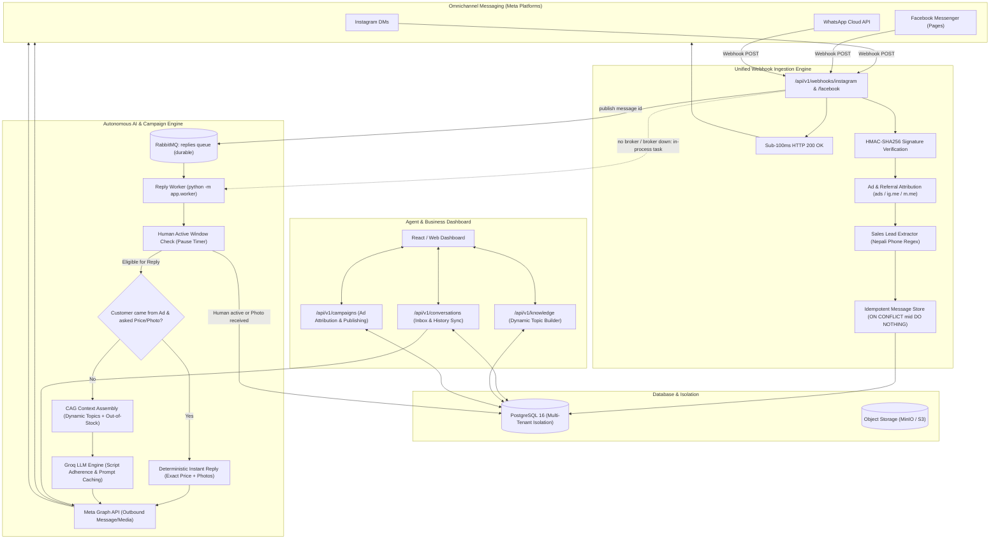
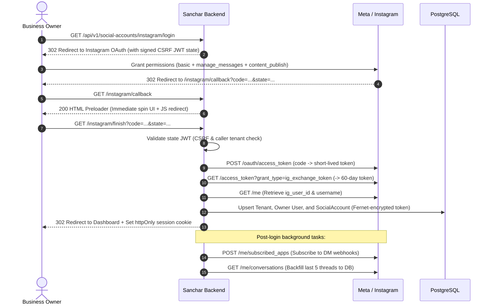
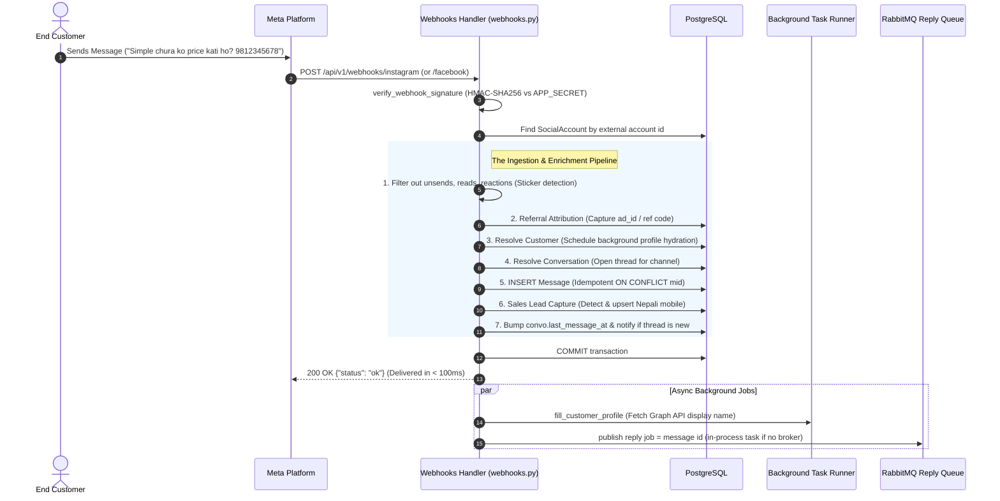
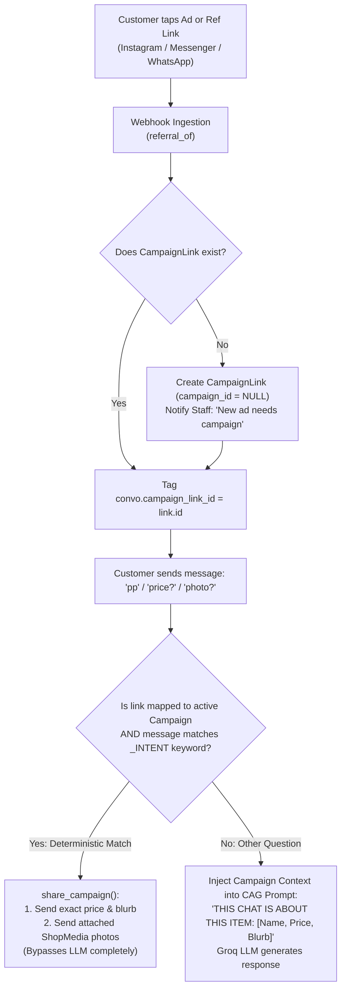
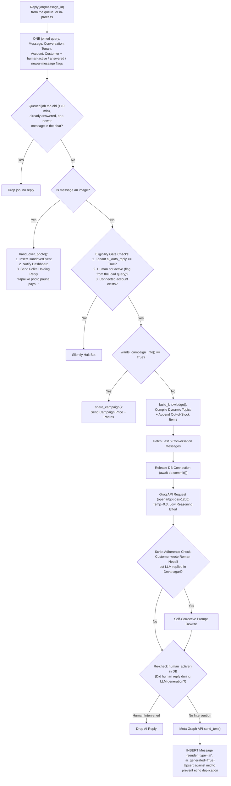
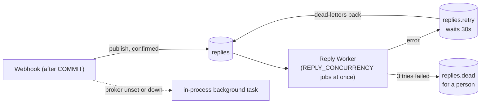

# Sanchar (NepSocial) End-to-End System Flow

Sanchar is a multi-tenant customer communication, lead generation, and autonomous AI auto-reply platform built for Nepali businesses. It unifies inbound messaging across **Instagram DMs**, **Facebook Messenger (Pages)**, and **WhatsApp Cloud API**, powers instant context-aware replies via Groq LLMs (using Cache-Augmented Generation / CAG in Roman Nepali, English, and Devanagari), provides deterministic ad-campaign price/photo responses, extracts sales leads automatically, and facilitates seamless human agent handovers.

---

## 1. High-Level Architecture

---

## 2. Multi-Tenant Foundation & Security Model

The system enforces strict multi-tenant boundaries at the database, session, and social integration layers:

* **Tenant Isolation**: Handled via `get_current_tenant` and `get_current_user` in `app/core/tenant.py`. Every query for conversations, messages, knowledge topics, media, leads, and campaigns filters strictly by `tenant_id` resolved from the caller's JWT. No tenant-owned entity is ever loaded by ID alone.
* **Token Encryption at Rest**: Sensitive third-party credentials (Meta 60-day Instagram access tokens, Facebook Page access tokens, WhatsApp System User tokens) are encrypted with Fernet symmetric cryptography (`encrypt_token` / `decrypt_token` in `app/core/security.py`) and decrypted only in-memory when making external HTTP requests.
* **Cross-Workspace Protection**: When connecting Facebook Pages via `_linked_instagram` in `app/api/v1/social_accounts.py`, the backend checks whether the Page's linked Instagram Business account is already connected to another tenant workspace. If so, connection is denied to prevent unauthorized cross-tenant eavesdropping.
* **Role-Based Access Control (RBAC)**: Managed via `require_role` (`app/core/tenant.py`):
  * `super_admin`: Platform-wide cross-tenant observability and tenant-level AI switches (`app/api/v1/admin.py`).
  * `owner`: Full workspace authority, billing, team invitations, social account linkage, and owner protections.
  * `admin`: Workspace configuration, dynamic knowledge topic authoring, media catalog, and ad campaigns.
  * `agent`: Omnichannel inbox operation, manual chat replies, and media catalog photo dispatch.

---

## 3. Social Channel Connection Lifecycles

### 1. Instagram Business OAuth (3-Hop Flow)
Implemented in `app/api/v1/social_accounts.py` and `app/services/meta/instagram.py`:

* **Hop 1 (`GET /instagram/login`)**: Generates a signed CSRF state JWT carrying caller identity and traffic origin, redirecting the browser to Meta.
* **Hop 2 (`GET /instagram/callback`)**: Instantly paints a lightweight preloader page (`_FINISH_PAGE`) that issues a JavaScript `location.replace("finish?...")` redirect to prevent browser hanging during external token exchanges.
* **Hop 3 (`GET /instagram/finish`)**: Exchanges the authorization code for a short-lived token, upgrades it to a 60-day token, and provisions the tenant, owner, and social account.
* **Post-Login Background Hook (`_after_login`)**: Registers webhook delivery (`POST /me/subscribed_apps`) and seeds initial conversation threads (`backfill_recent_conversations`).

### 2. Facebook Messenger (Pages)
Implemented in `app/services/meta/facebook.py` and `app/api/v1/social_accounts.py`:
* **OAuth Connect**: `GET /social-accounts/facebook/login` redirects the logged-in admin to Meta's dialog (`pages_messaging`, `pages_manage_metadata`, `pages_show_list`). The callback (`/facebook/callback`) exchanges the code for a long-lived user token, inspects all granted Pages (`/me/accounts`), verifies cross-workspace Instagram ownership, subscribes each Page to `messages,message_echoes`, and stores the Page tokens.
* **Direct Connect**: Admins can also manually link a Page by providing its Page ID and token (`POST /social-accounts/facebook`).

### 3. WhatsApp Cloud API
Implemented in `app/services/meta/whatsapp.py` and `app/api/v1/social_accounts.py`:
* Utilizes a platform System User token (`WABA_TOKEN`).
* Partner Linking: Business provides `waba_id` and `phone_number_id` (`POST /social-accounts/whatsapp`). The backend verifies number status (`fetch_waba_phone_numbers`), registers the webhook subscription (`subscribe_app`), and records the social account.

---

## 4. Webhook Ingestion Engine & Signal Routing

All Meta webhook traffic routes through `POST /api/v1/webhooks/instagram` and `POST /api/v1/webhooks/facebook` in `app/api/v1/webhooks.py`.

### The Ingestion Pipeline Steps:
1. **Event Filtering**: Discards message deletions (`is_deleted`), reads, delivery reports, and reactions. Messenger thumbs-up stickers (`sticker_id`) are classified as `message_type="sticker"`, preventing false photo handovers.
2. **Referral Attribution (`referral_of` & `apply_referral`)**: Extracts ad IDs (`ad_id`, `source_id`), referral codes (`ref`), ad titles, and thumbnail images across Instagram ads, Messenger ads, click-to-WhatsApp ads, and `ig.me?ref=` / `m.me?ref=` links. Automatically registers unmapped links in `campaign_links` and notifies staff.
3. **Customer Resolution**: Fetches or inserts the `Customer`. Name resolution from Graph API is offloaded to a background task (`fill_customer_profile`) to keep database connections free.
4. **Conversation Thread**: Matches the active `open` conversation for that channel and customer via partial index `uq_open_conversation`.
5. **Idempotent Message Store**: Inserts the message record with PostgreSQL `ON CONFLICT (external_message_id) DO NOTHING`.
6. **Automatic Sales Lead Capture (`capture_lead`)**: Scans inbound text for mobile numbers. If detected, records or updates the customer's phone and upserts a `SalesLead`.
7. **Timestamps & Notifications**: Updates `conversation.last_message_at`. If the thread is new and not an agent echo, creates an in-app notification.
8. **Sub-100ms Acknowledgment**: Transaction commits and returns `200 OK` to Meta immediately before firing background tasks.

---

## 5. Sales Leads Capture Engine

Implemented in `app/models/sales_lead.py`, `app/services/leads.py`, and `scripts/backfill_leads.py`:

* **Extraction Heuristic**:
  * Normalizes Devanagari numerals (`०१२३४५६७८९` -> `0123456789`).
  * Regex pattern `(?<!\d)(?:(?:\+|00)?977[\s-]?)?(9[78](?:[\s-]?\d){8})(?!\d)` isolates valid Nepali mobile numbers (97/98 series with 8 following digits).
  * Standardizes all captured numbers to E.164 format: `+977XXXXXXXXXX`.
* **Lead Upsert & Lifecycle**:
  * Saves to `sales_leads` table (`tenant_id`, `customer_id`, `conversation_id`, `source_message_id`, `channel`, `phone`, `status`, `metadata`).
  * Unique constraint on `(tenant_id, customer_id)` ensures a single lead record per customer; subsequent numbers update the record.
  * Dispatches an in-app notification (`lead_captured`) alerting sales agents.
  * Operates on webhook commit, capturing leads even if AI auto-reply is disabled or the customer is talking to a human agent.
* **Historical Backfilling (`scripts/backfill_leads.py`)**:
  Allows administrators to parse historical conversation logs and extract existing numbers into the sales leads table without spamming notifications.

---

## 6. Ad Campaigns, Referrals & Deterministic Replies

Implemented in `app/models/campaign.py`, `app/api/v1/campaigns.py`, and `app/services/campaigns.py`:

### 1. Inbound Attribution & Link Mapping
* Every message originating from a boosted post, Click-to-Message ad, or bio link (`?ref=CODE`) carries referral metadata.
* Unmapped ads register themselves automatically. Staff can assign them to a campaign via `PATCH /api/v1/campaigns/links/{link_id}`, retroactively mapping all past and future chats from that ad.

### 2. Instant Deterministic Price & Photo Auto-Reply (`share_campaign`)
* When an ad-referred customer sends a short inquiry (<= 40 characters) matching price, color, or photo keywords (`pp`, `price`, `rate`, `cost`, `kati`, `mulya`, `rang`, `photo`, `tasbir`, `dekhau`), the bot **bypasses the LLM entirely**.
* Instantly transmits the campaign's exact price text (`Rs 3,350 price, pure chinnon silk fabric...`).
* Dispatches up to 5 attached in-stock photos from `ShopMedia`.
* Enforces a 24-hour photo cooldown (`PHOTO_COOLDOWN`) to avoid re-sending the same photo set in the same conversation.

### 3. Follow-up Context Injection
If the customer asks an open-ended question (e.g., *"Do you have this in size XL and can it be delivered to Pokhara?"*), the campaign's name, price, and details are injected into the CAG system prompt as the primary subject of inquiry.

### 4. Direct Instagram Feed Publishing
Staff can post an uploaded photo directly to the business Instagram account (`POST /api/v1/campaigns/{id}/publish` and `POST /api/v1/shop_media/{id}/post`) using Meta's `instagram_business_content_publish` scope. Sanchar records the resulting `ig_post_id` and permalink, allowing subsequent ad boosts of that post to be automatically traced back to the campaign.

---

## 7. Autonomous CAG Auto-Reply Pipeline

Implemented in `app/services/reply_pipeline.py` and `app/services/auto_reply.py`; delivery by `app/services/reply_queue.py` and `app/worker.py` (see "Reply Queue" below):

### Core Pipeline Safeguards:
* **The Sliding Human Takeover Window (`human_active`)**: Checks if any `agent` message was sent in this thread within the last `HUMAN_PAUSE_MINUTES` (default: 10 min). Any staff reply—from the Sanchar inbox or native Meta apps—silences the bot.
* **Photo Handover Protocol (`hand_over_photo`)**: Incoming photos trigger a `HandoverEvent`, alert the team, and dispatch a polite holding message:
  > *"Tapai ko photo pauna payo. Hamro team le herera chadai reply garnu hunchha. (Thanks for the photo, our team will check it and reply shortly.)"*
* **Connection Pool Optimization**: Before invoking external LLM or Graph API endpoints (1–3 seconds), `await db.commit()` releases the database connection back to the pool, preventing connection exhaustion under heavy load.
* **Script Mirroring & Corrective Loop**:
  * Customer messages in Roman Nepali receive Roman Nepali replies; Devanagari receives Devanagari; English receives English.
  * If the model inadvertently answers in Devanagari for a Roman Nepali inquiry, a corrective retry re-prompts the model before sending.
* **One Query, Not Five**: the message, conversation, tenant, account and customer load in a single joined query, and the "is a person handling this chat" flag (plus, for queued jobs, the "already answered" and "newer message" flags) ride along in it. A reply costs 5 SQL statements and 3 short DB transactions in total; the connection is never held across the LLM or Meta calls.
* **Shop Knowledge Cache**: `build_knowledge` is cached per tenant per process for `KNOWLEDGE_CACHE_SECONDS` (default 30), so a knowledge edit or a sold-out toggle can take that long to reach the bot.
* **Pre-Send Race Condition Check**: Immediately before dispatching the reply to Meta, the pipeline re-checks `human_active()`. If an agent replied while the LLM was computing, the bot drops its reply.

### Reply Queue (RabbitMQ)

The reply is a separate job, so the webhook acknowledges Meta without waiting for it. The job is just the message id; `auto_reply` reloads everything from the database.

* **Delivery**: queues are durable, messages persistent, publishes wait for the broker's confirm, and the worker acks only after a failed job has been republished. A crash mid-job redelivers it. This is at-least-once: a crash between sending the DM and storing the reply can still send one duplicate.
* **Fallback**: with `RABBITMQ_URL` unset, or the broker unreachable (retried at most every 10s so webhooks do not each wait on it), the webhook runs the job in-process as before. That path loses in-flight replies on a restart.
* **Jobs that are dropped, not sent**: older than `REPLY_MAX_AGE_MINUTES` (10), already followed by an AI or agent message in the chat (redelivery), or followed by a newer customer message (that message's job answers, with this one in its history). A late or doubled DM is worse than none.
* **Retries**: an LLM failure raises, so the job goes to `replies.retry` and returns after `REPLY_RETRY_SECONDS`; after 3 tries it lands in `replies.dead`. A failed Meta send is not retried, because it may already have gone out.
* **Scaling order**: raise `REPLY_CONCURRENCY` first. A call waiting on the LLM costs no CPU, and it also sets the HTTP connection limit (`max(100, REPLY_CONCURRENCY + 50)`, which would otherwise cap calls in flight at 100). One process measured about 14 ms of CPU per reply (about 70 replies/s). Add worker processes (`docker compose up -d --scale worker=N`) only when a worker's CPU saturates, and keep `N x (pool_size + max_overflow)` under Postgres `max_connections`.
* **Worker pool**: the worker runs with `DB_POOL_PRE_PING=false`, saving a round trip per checkout (about 2 ms per reply). A dead pooled connection fails one job, which the queue retries.
* **Measured** (50 msgs/s, local mocks, one machine): one worker at concurrency 130 gave reply latency p50 4.6s and p95 5.9s with no stored message lost, against p50 74s and p95 167s with in-process replies. Details and caveats in `docs/load-test-report.md`.

---

## 8. Dynamic Topic Knowledge Base & Media Catalog

### 1. Dynamic Topic Builder (`app/api/v1/knowledge.py`)
* Replaced rigid fixed sections with **custom dynamic topics** (`TopicIn`, `TopicOut`).
* Businesses create topics tailored to their specific industry (e.g., Courses & Fees for Consultancies, Services & Booking for Salons, Sizing & Exchanges for Clothing).
* Provides industry starter templates across General, Clothing, Gifts, Consultancy, and Nail Salon.
* Total context size is capped at 30,000 characters across all topics combined.
* Live dry-run testing endpoint (`POST /api/v1/knowledge/test`) validates bot responses against the active knowledge base without messaging customers.

### 2. Shop Media & Inventory Catalog (`app/api/v1/shop_media.py`)
* **Automated Sync**: Synchronizes the 9 newest Instagram posts every 15 minutes (`fetch_media`), caching media URLs and permalinks.
* **Direct Uploads**: Uploads images to S3/MinIO (JPG, PNG, WebP up to 5 MB) with byte-level MIME sniffing.
* **Campaign Linking**: Photos can be attached to campaigns to serve as automatic product showcase images.
* **Real-Time Stock Flagging (`in_stock`)**: Items toggled out of stock are dynamically appended to the CAG prompt:
  > *"SOLD OUT right now (do not offer these): [Titles]"*

---

## 9. Agent Inbox, Historical Sync & Admin Controls

### 1. Enriched Conversation Inbox (`app/api/v1/conversations.py`)
* Inbox listing provides thread metadata including `channel`, `last_message_at`, `lead_phone`, `campaign_name`, `ad_title`, `ad_kind`, and `ad_code`.
* **Dynamic `needs_attention` Flag**: Evaluates to `true` whenever an active handover event exists without a subsequent human agent response. Clears automatically once an agent replies.

### 2. Historical Thread Synchronization (`sync_history`)
* Staff can click "Load older chats" (`POST /api/v1/conversations/sync-history`) to backfill past conversations from Instagram and Messenger in batches of 50 via Meta's cursor-based pagination.
* Uses an optimistic locking timestamp (`history_syncing_at` with a 10-minute lock window) to prevent concurrent sync operations on the same account.

### 3. Agent Outbound Messaging
* **Text Messages (`POST /conversations/{id}/messages`)**: Sends messages over Instagram, Messenger, or WhatsApp, logs `sender_type="agent"`, and pauses the bot.
* **Media Catalog Sharing (`POST /conversations/{id}/media`)**: Allows agents to pick verified shop media and transmit public image attachments directly into Instagram DMs.

### 4. Conversational Analytics & Administration
* **Dashboard Analytics (`app/api/v1/dashboard.py`)**: Computes channel volume distribution and uses regex heuristics (`_is_question`) covering English and Nepali question markers (*kati*, *kasari*, *kaha*, *kahile*, *kina*, *kun*, *milcha*, *paincha*) to surface top customer inquiries.
* **Super-Admin Console (`app/api/v1/admin.py`)**: Cross-tenant observability for platform operators with a master toggle for tenant AI auto-reply.

---

## 10. Key Architectural Guarantees

| Requirement | Implementation Mechanism |
| :--- | :--- |
| **Strict Multi-Tenancy** | Every query filters on `tenant_id` resolved from the session JWT via `get_current_tenant`. |
| **Cross-Workspace Safety** | Facebook Pages verify that their linked Instagram account does not belong to another workspace before linking. |
| **Webhook Delivery Speed** | Immediate acknowledgment (< 100ms); name hydration, sales lead parsing, and AI processing execute asynchronously. |
| **Connection Pool Protection** | Database connections are explicitly released via `await db.commit()` prior to external HTTP calls (Groq LLM and Meta Graph API). |
| **Deterministic Ad Answers** | Inbound inquiries on ad campaigns trigger instant exact price & photo replies, bypassing LLM latency and hallucination risks. |
| **Automated Lead Capture** | Nepali mobile numbers are parsed from messages using regex and stored in `sales_leads`, independent of bot status. |
| **Replies Survive Restarts** | Jobs sit in a durable RabbitMQ queue and are acked only after processing; retries, a dead-letter queue and a 10-minute staleness cutoff bound what a restart or outage can replay. |
| **Human Agent Priority** | Dynamic sliding window (`human_pause_minutes`) ensures human replies always take precedence over automated bot responses. |
| **Message Deduplication** | PostgreSQL `ON CONFLICT` constraints on `external_message_id` prevent duplicate messages from webhook retries and outbound message echoes. |
